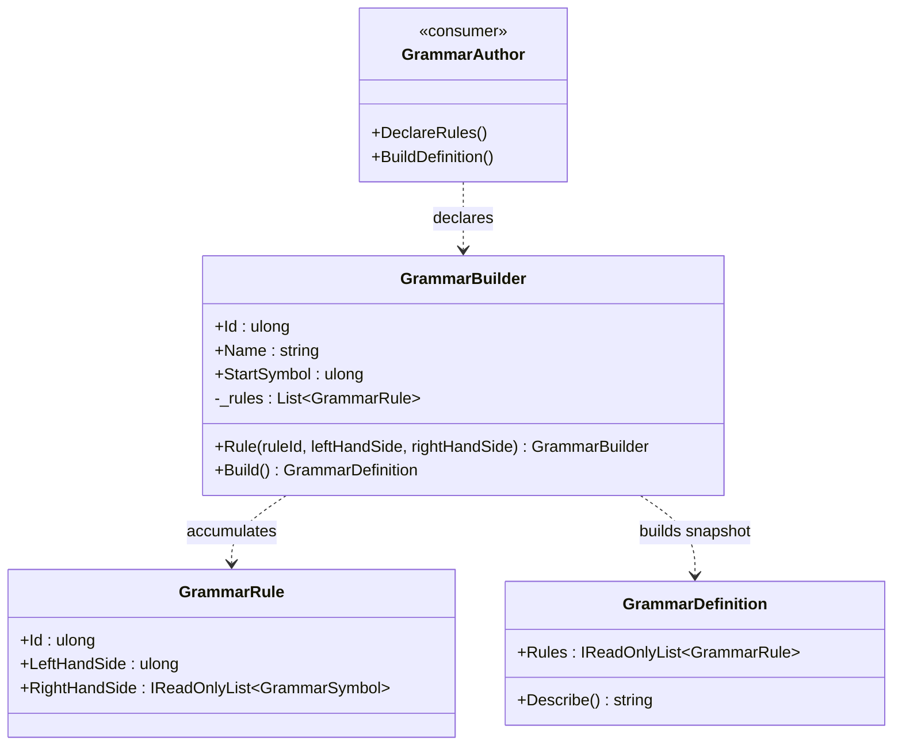

<!-- The Singularity Workshop moniker -->

  

# GrammarBuilder — grammar construction workflow

## Purpose

`GrammarBuilder` is the mutable authoring surface for a grammar. It holds the grammar's identity, name, start nonterminal, and the sequence of production rules being declared. Calling `Build()` hands that accumulated data to `GrammarDefinition`, which performs whole-grammar structural checks and creates the immutable snapshot.

The builder is a construction tool, not a parser, protocol registry, model client, policy engine, or command executor.

## Responsibility boundary

- **Owns during authoring:** grammar ID, name, start-symbol ID, and a private ordered list of rules.
- **Checks immediately:** constructor requires nonzero grammar and start-symbol IDs and a nonblank name; each `Rule(...)` call delegates per-rule checks to `GrammarRule`.
- **Checks at build time:** delegates whole-grammar validation to `GrammarDefinition`, including unique rule IDs, a production for the start symbol, and productions for referenced nonterminals.
- **Does not do:** resolve external protocol references, parse candidate text, prove semantic correctness, or authorize execution.

A successful `Build()` returns a snapshot. Later calls to `Rule(...)` mutate the builder's pending list, not the already-built definition.

## UML class card

## Use cases

1. **Fluent declaration:** chain `Rule(...)` calls to describe alternatives and ordered right-hand-side symbols.
2. **Explicit epsilon:** pass an empty symbol array to declare a production whose right-hand side is empty.
3. **Build a stable artifact:** call `Build()`, then retain and inspect the returned definition while continuing to author another version.
4. **Separate error timing:** handle argument errors during authoring separately from whole-grammar errors raised by `Build()`.

## Source of truth

Implementation: [`GrammarBuilder.cs`](https://github.com/TrentBest/TheSingularityWorkshop.GrammarAi/blob/development/GrammarBuilder.cs).