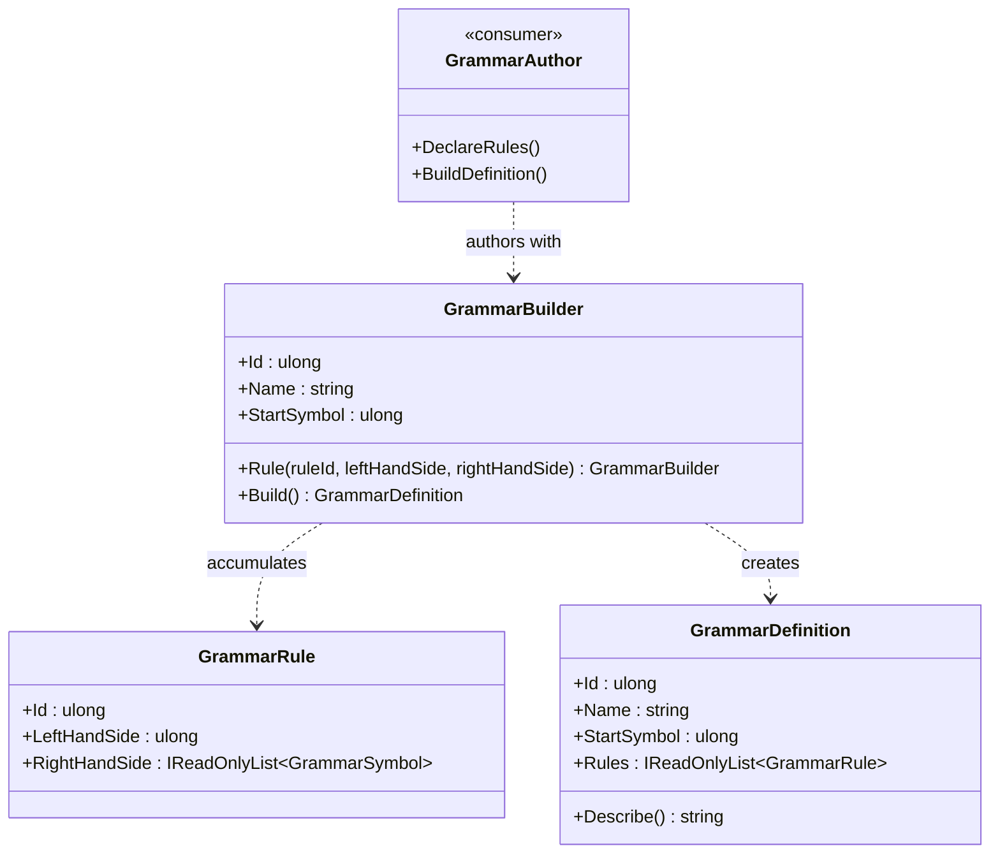

<!-- The Singularity Workshop moniker -->

  

# GrammarBuilder — UML and use cases

## Class relationships

The authoring consumer is above the focal class. The builder accumulates rules and produces a validated immutable definition.

## Use cases

### Declare productions
Call `Rule(ruleId, leftHandSide, rightHandSide)`. The builder appends a new `GrammarRule` and returns itself for chaining. Duplicate rule IDs are rejected when the complete definition is built, rather than by the builder's `Rule` method.

### Build and continue authoring
Call `Build()` to obtain an immutable snapshot. The definition is independent of later additions to the builder's rule list.

### Understand validation boundaries
The builder checks basic grammar metadata at construction and delegates whole-grammar structural validation to `GrammarDefinition`. It does not resolve external protocol references, parse text, or authorize actions.

See [`GrammarBuilder.md`](GrammarBuilder.md) for the class card and detailed responsibility boundary.

---

<!-- THE SINGULARITY WORKSHOP FOOTER -->

