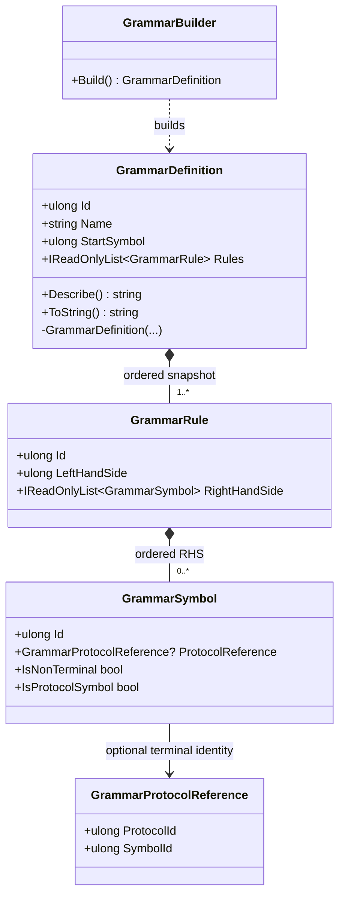

<!-- The Singularity Workshop moniker -->

  

# GrammarDefinition — immutable grammar artifact

## Purpose

`GrammarDefinition` is the immutable, self-describing result of building a GrammarAi grammar. It owns the grammar's nonzero identity, name, start nonterminal, and ordered production-rule snapshot.

A definition describes structure; it does not parse candidate text, load external protocol definitions, prove terminal references exist, authorize a meaning, or execute commands.

## Responsibility boundary

- **Owns:** grammar identity and name, start-symbol identity, ordered rules, internal structural checks, deterministic `Describe()` output.
- **Checks during construction:** nonzero grammar/start identities and valid name; unique rule IDs; start symbol has a production; every right-hand-side nonterminal has a production.
- **References but does not own:** protocol terminals identified by protocol ID and symbol ID.
- **Leaves to the host or a separate downstream component:** linking external protocol references, parsing or validating candidate output against the grammar, policy, authorization, and execution.

The constructor is internal; consumers normally obtain a definition through `GrammarBuilder.Build()`.

## UML class card

The rule collection can be empty only if construction rules permit it; the current implementation requires the start symbol to appear as a rule's left-hand side, so a successfully built definition has at least one rule. The empty right-hand side of an individual rule is allowed and represents epsilon.

## Use cases

1. **Inspect a built grammar:** read `Id`, `Name`, `StartSymbol`, and `Rules` without mutating the definition.
2. **Display or compare a definition:** call `Describe()` for a deterministic textual representation in rule declaration order.
3. **Prepare host-side linking:** enumerate terminal symbols and resolve their protocol/symbol identities against the protocol definitions selected by the application.
4. **Keep validation layers distinct:** use construction checks to establish internal well-formedness, then use separate host components for external linking, candidate conformance, and authorization.

## Source of truth

Implementation: [`GrammarDefinition.cs`](https://github.com/TrentBest/TheSingularityWorkshop.GrammarAi/blob/development/GrammarDefinition.cs). This document describes the current source contract, not a parser or provider adapter that the package does not implement.
