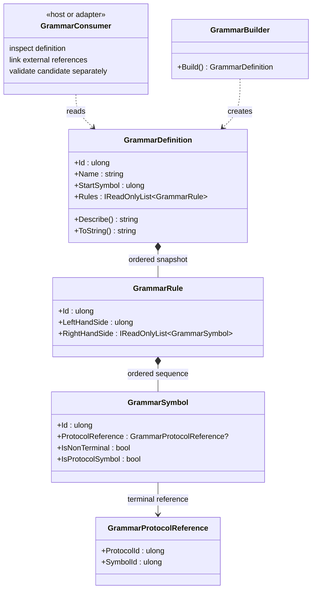

<!-- The Singularity Workshop moniker -->

  

# GrammarDefinition — UML and use cases

## Class relationships

The focal class is `GrammarDefinition`. Its consumer-facing users are above it; the immutable rule and symbol data it exposes are below it.

## Use cases

### Inspect and describe
A host builds a definition, reads its immutable rule snapshot, and uses `Describe()` to log or present the grammar.

### Link protocol terminals
A host finds each `GrammarSymbol` with `IsProtocolSymbol == true`, then resolves its `ProtocolId` and `SymbolId` against the chosen protocol definitions. A successful grammar build alone does not perform this linking.

### Validate a candidate
A separate parser, validator, or provider adapter may consume the grammar to check candidate structure. GrammarDefinition itself does not parse or validate arbitrary candidate text.

### Authorize an operation
The host independently checks meaning, context, permissions, and policy before any consequential action. Neither a well-formed grammar nor a resolved protocol identity is authorization.

## Invariants represented by this class

- Grammar identity and start-symbol identity are nonzero.
- The name is not null, empty, or whitespace.
- Rule IDs are unique.
- The start symbol has at least one production.
- Every nonterminal appearing on a right-hand side has a production.
- Rule declaration order and each right-hand-side sequence order are preserved in the snapshot.
- An empty right-hand side is explicit epsilon, not an absent production.

See [`GrammarDefinition.md`](GrammarDefinition.md) for the companion class card and responsibility boundary.
