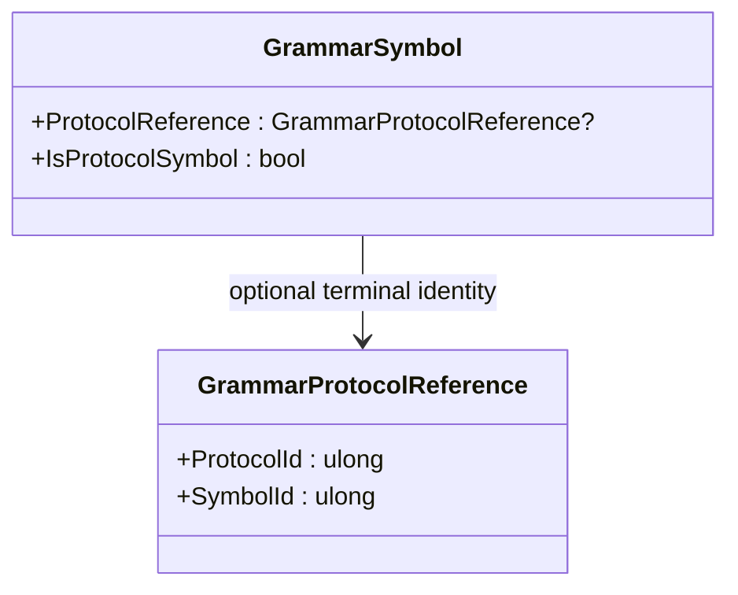

<!-- The Singularity Workshop moniker -->

  

# GrammarProtocolReference — external terminal identity

## Purpose

`GrammarProtocolReference` is a small, immutable value that identifies a terminal symbol owned by an external protocol. It carries two coordinates: the protocol ID and the symbol ID within that protocol. GrammarAi can retain this identity without owning the external vocabulary.

This reference is an address, not a copy of the protocol symbol's meaning and not proof that the identity exists in a particular protocol registry.

## Responsibility boundary

- **Owns:** the nonzero `ProtocolId` and nonzero `SymbolId` values.
- **Checks on construction:** either ID being zero raises `ArgumentOutOfRangeException`.
- **Does not do:** look up a protocol, resolve a symbol name, verify compatibility between protocol versions, or authorize use of the symbol.

The application chooses the relevant protocol definitions and is responsible for resolving references and handling missing or incompatible identities.

## UML class card

## Use cases

1. **Identify a terminal:** preserve the protocol and symbol IDs needed for later host-side linking.
2. **Keep vocabulary ownership separate:** grammar productions can refer to a protocol symbol without copying or redefining its meaning.
3. **Validate at the right layer:** validate nonzero identity at construction, then resolve existence and compatibility against the application's selected protocol data.

## Source of truth

Implementation: [`GrammarProtocolReference.cs`](https://github.com/TrentBest/TheSingularityWorkshop.GrammarAi/blob/development/GrammarProtocolReference.cs).