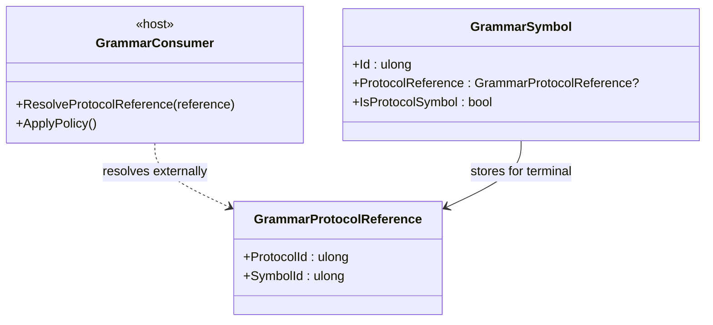

<!-- The Singularity Workshop moniker -->

  

# GrammarProtocolReference — UML and use cases

## Class relationships

## Use cases

### Resolve external identity
A host reads `ProtocolId` and `SymbolId` and looks them up in the protocol definitions selected for the application. GrammarAi's value object does not perform that lookup.

### Preserve vocabulary boundaries
The reference lets a grammar use a protocol-owned terminal without becoming the owner of that terminal's meaning.

### Avoid overclaiming
A nonzero reference is syntactically valid as an identifier pair; it does not prove that the protocol or symbol exists, that versions are compatible, or that a use is authorized.

See [`GrammarProtocolReference.md`](GrammarProtocolReference.md) for the class card and contract.