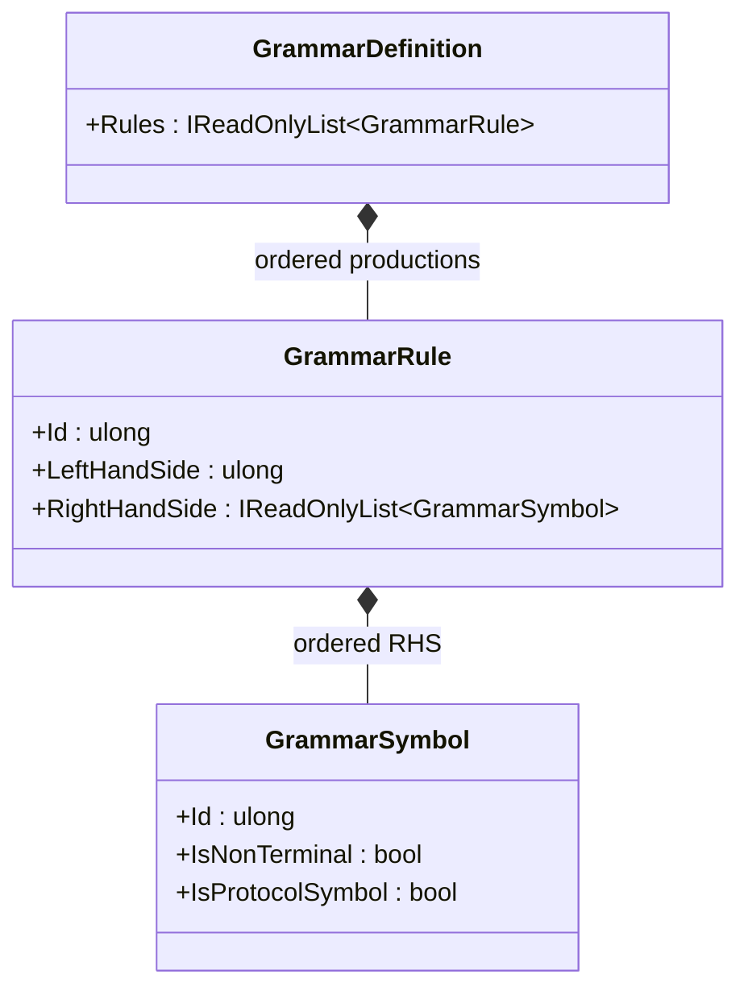

<!-- The Singularity Workshop moniker -->

  

# GrammarRule — one production in a grammar

## Purpose

A `GrammarRule` states that one nonterminal (the left-hand side) may expand to an ordered sequence of symbols (the right-hand side). Several rules may share the same left-hand-side nonterminal; those rules represent alternative productions. The order of symbols within each individual right-hand side is meaningful.

An empty right-hand side is an explicit epsilon production. It is not the same as a missing rule for a nonterminal.

## Responsibility boundary

- **Owns:** a nonzero rule ID, a nonzero left-hand-side nonterminal ID, and a snapshot of the right-hand-side symbols.
- **Checks on construction:** IDs cannot be zero and the right-hand-side enumerable cannot be null.
- **Snapshots input:** enumerates the supplied sequence into an array and exposes it through a read-only wrapper, so later changes to the input collection do not change the rule.
- **Does not check alone:** rule-ID uniqueness across a grammar, whether the start symbol has a production, or whether every referenced nonterminal has a production. Those checks belong to `GrammarDefinition`.
- **Does not do:** parse strings, resolve protocol references, or decide authorization.

## UML class card

## Use cases

1. **Represent an alternative:** create multiple rules with the same `LeftHandSide` but distinct rule IDs.
2. **Represent a sequence:** provide right-hand-side symbols in the order they must appear in the production.
3. **Represent epsilon:** supply an empty sequence.
4. **Build immutable grammar data:** let `GrammarDefinition` validate how this rule relates to the complete set of rules.

## Source of truth

Implementation: [`GrammarRule.cs`](https://github.com/TrentBest/TheSingularityWorkshop.GrammarAi/blob/development/GrammarRule.cs).