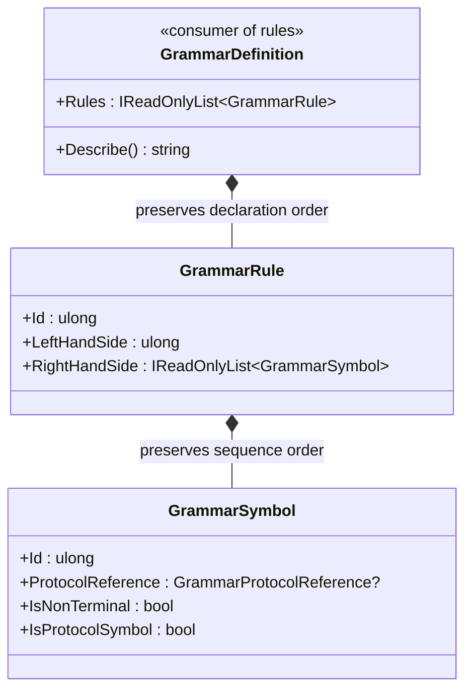

<!-- The Singularity Workshop moniker -->

  

# GrammarRule — UML and use cases

## Class relationships

## Use cases

### Alternative productions
Two rules may expand the same left-hand-side nonterminal. They are alternatives at the grammar level; this class does not choose which one a parser or downstream consumer uses.

### Ordered composition
The right-hand-side list preserves the declared symbol order. Consumers should not treat it as an unordered set.

### Epsilon
An empty right-hand side explicitly represents epsilon. A nonterminal with no production is a different condition and is rejected by whole-definition validation when referenced.

### Validation boundary
The rule enforces local construction invariants only. `GrammarDefinition` checks cross-rule relationships, while external protocol linking and candidate conformance remain separate responsibilities.

See [`GrammarRule.md`](GrammarRule.md) for the class card and detailed contract.