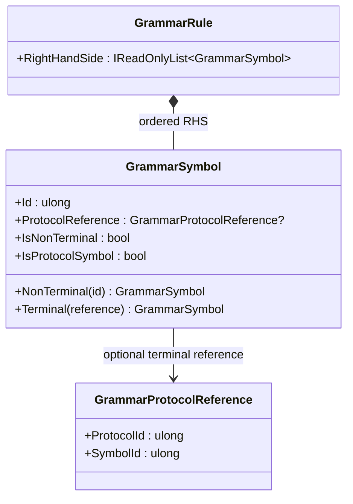

<!-- The Singularity Workshop moniker -->

  

# GrammarSymbol — terminal or nonterminal

## Purpose

`GrammarSymbol` is the value used in a production's right-hand-side sequence. It represents one of two distinct things:

- **Nonterminal:** an integer identity owned by the grammar; it can be expanded by grammar productions.
- **Protocol terminal:** a symbol identity owned by an external protocol, represented by a `GrammarProtocolReference`.

The distinction is explicit in the value: `ProtocolReference` is null for a nonterminal and populated for a protocol terminal. `IsNonTerminal` and `IsProtocolSymbol` expose those complementary cases.

## Responsibility boundary

- **Owns:** a nonzero symbol ID and an optional protocol reference.
- **Factory methods:** `NonTerminal(id)` creates a grammar-owned nonterminal; `Terminal(reference)` creates a protocol-terminal symbol.
- **Does not do:** look up protocol definitions, parse candidate text, determine semantic truth, or authorize an operation.
- **Whole-grammar checks:** `GrammarDefinition` ensures nonterminals referenced on right-hand sides have productions. External terminal resolution is separate.

## UML class card

## Use cases

1. **Declare an expandable category:** use `GrammarSymbol.NonTerminal(id)` for a symbol that has grammar productions.
2. **Reference a protocol-owned terminal:** use `GrammarSymbol.Terminal(reference)` with the external protocol/symbol identity.
3. **Validate the complete grammar:** let the built definition check that referenced nonterminals have productions.
4. **Resolve and interpret:** let the host resolve terminal references and interpret application meaning; the symbol object itself is not a semantic validator.

## Source of truth

Implementation: [`GrammarSymbol.cs`](https://github.com/TrentBest/TheSingularityWorkshop.GrammarAi/blob/development/GrammarSymbol.cs).

---

<!-- THE SINGULARITY WORKSHOP FOOTER -->

