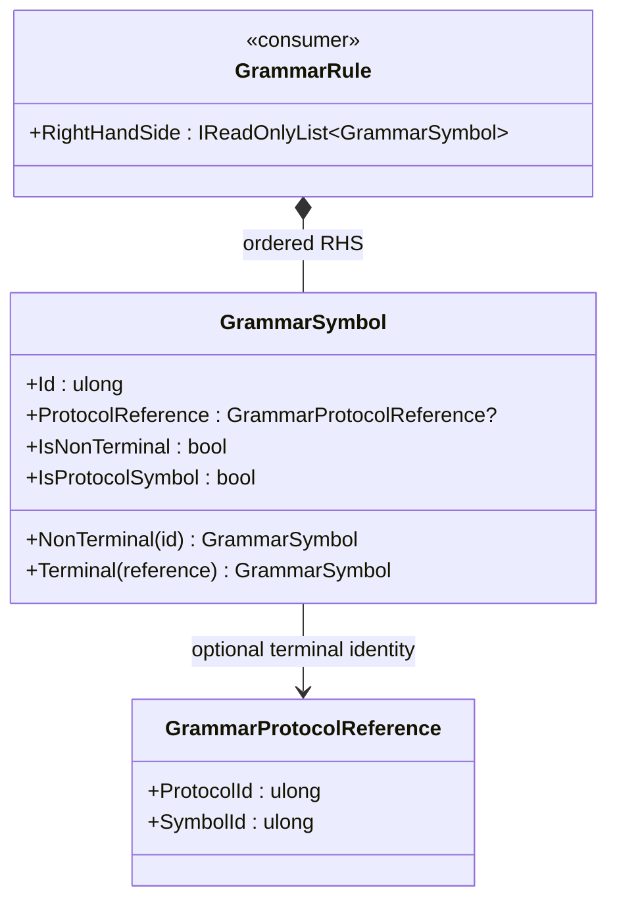

<!-- The Singularity Workshop moniker -->

  

# GrammarSymbol — UML and use cases

## Class relationships

## Use cases

### Create a nonterminal
Use `NonTerminal(id)` for grammar-owned symbols. The whole definition later checks that any such symbol referenced in a right-hand side has a production.

### Create a protocol terminal
Use `Terminal(reference)` to preserve the identity pair of a symbol owned by an external protocol. This does not resolve the identity against a protocol registry.

### Keep semantics separate from structure
The symbol discriminates grammar structure from external vocabulary identity; it does not parse, establish truth, or authorize actions.

See [`GrammarSymbol.md`](GrammarSymbol.md) for the class card and detailed contract.