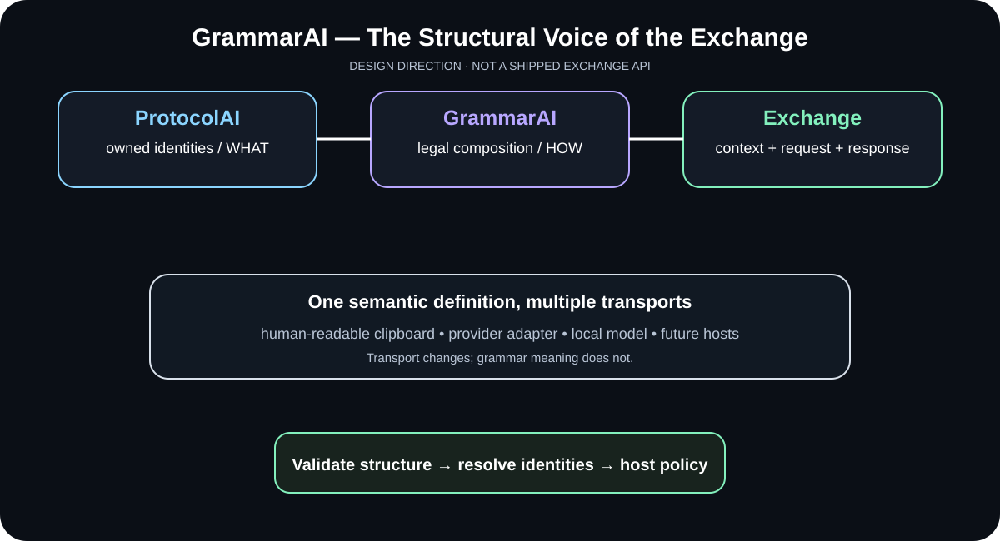

# GrammarAi Gallery

GrammarAi's visual explains the boundary between protocol-owned vocabulary and grammar-owned structure: ProtocolAi answers what a symbol means, while GrammarAi describes how symbol identities may be composed. The current SVG is an authored explanatory diagram, not source-derived UML or a live runtime trace.

## Visual tour

### Give meaning a language


The diagram shows protocol terminals, grammar rules, and the host-side consumer. GrammarAi owns production structure; it does not own external vocabularies, call a model, or execute the resulting content.

### Exchange composition (design direction)



This is a conceptual view preserved from the exchange-foundation work. Provider adapters, response parsing, and the exchange orchestration are not implemented by GrammarAi itself.

## See actual behavior

From the repository root:

```bash
dotnet run --project examples/GrammarAi.QuickStart/GrammarAi.QuickStart.csproj
dotnet test tests/GrammarAi.Tests/GrammarAi.Tests.csproj --configuration Release
```

The quick start uses the public API. Tests exercise protocol-terminal references, nonterminal validation, recursive productions, epsilon, deterministic descriptions, and immutable snapshots. The SVG is the orientation aid; the example and tests are the evidence.

## Detailed recipe

Read [Examples](EXAMPLES.md), [Consuming GrammarAi](CONSUMING.md), [Theory](THEORY.md), and [Release Readiness](RELEASE_READINESS.md).
