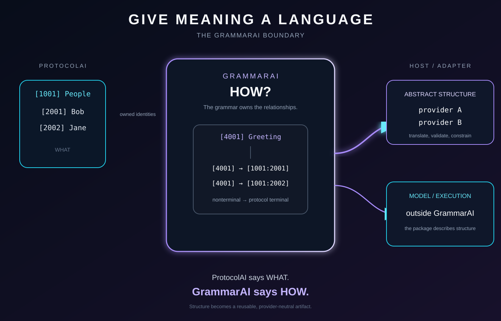
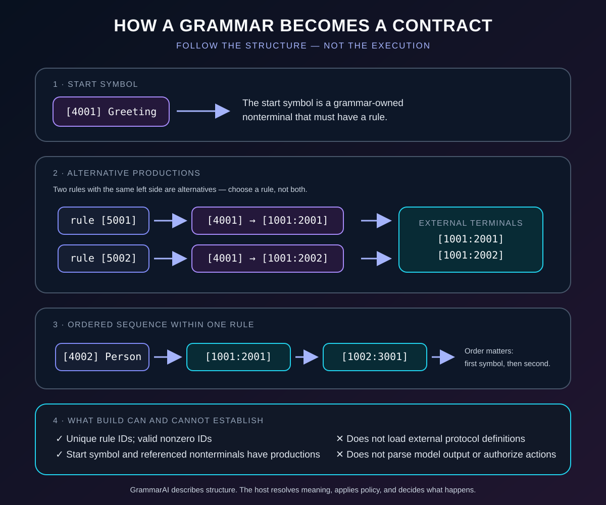

<!-- The Singularity Workshop moniker -->
<p align="center">
  <a href="https://github.com/TrentBest">
    
  </a>
</p>

# GrammarAi Gallery

GrammarAi's visual explains the boundary between protocol-owned vocabulary and grammar-owned structure: ProtocolAi answers what a symbol means, while GrammarAi describes how symbol identities may be composed. The current SVG is an authored explanatory diagram, not source-derived UML or a live runtime trace.

## Visual tour

### Give meaning a language



The diagram shows protocol terminals, grammar rules, and the host-side consumer. GrammarAi owns production structure; it does not own external vocabularies, call a model, or execute the resulting content.

## Learn the grammar step by step



This animation separates three ideas that are easy to confuse:

1. **Start symbol:** the grammar's entry point is a nonterminal owned by the grammar.
2. **Alternative rules vs. sequence:** multiple productions for the same left-hand side offer alternatives; the symbols on one rule's right-hand side form an ordered sequence.
3. **Structural validity vs. linked meaning:** building a grammar checks its internal shape. It does not load the referenced ProtocolAI definitions, prove that a chosen symbol is meaningful in the current application, parse arbitrary model output, or authorize an action.

The visual is an authored teaching aid. Its motion explains the concepts; it is not a live trace of the library executing. The executable example and tests remain the way to inspect real behavior.

### The contract in one glance

| GrammarAI checks when building | The host or another layer must still decide |
|---|---|
| Grammar, start-symbol, rule, and symbol identifiers are nonzero | Whether referenced protocol and symbol identities exist in the intended vocabulary |
| Rule IDs are unique within the grammar | Whether the grammar expresses the application's intended meaning |
| The start symbol has a production | Whether a model response conforms to the grammar |
| Every referenced nonterminal has a production | Whether a result is authorized, safe, or appropriate to execute |

A structurally valid grammar is a useful artifact, not a certificate of semantic truth or permission to act.

## See actual behavior

From the repository root:

```bash
dotnet run --project examples/GrammarAi.QuickStart/GrammarAi.QuickStart.csproj
dotnet test tests/GrammarAi.Tests/GrammarAi.Tests.csproj --configuration Release
```

The quick start uses the public API. Tests exercise protocol-terminal references, nonterminal validation, recursive productions, epsilon, deterministic descriptions, and immutable snapshots. The SVG is the orientation aid; the example and tests are the evidence.

## Detailed recipe

Start with [Consuming GrammarAi](CONSUMING.md), then explore [Examples](EXAMPLES.md) for runnable grammar definitions.

---

<p align="center">
  <a href="https://github.com/TrentBest">
    
  </a>
</p>

<p align="center">
  <a href="https://github.com/TrentBest">GitHub</a> ·
  <a href="https://coderlegion.com/">Coder Legion</a> ·
  <a href="https://www.patreon.com/c/TheSingularityWorkshop">Patreon</a> ·
  <a href="https://www.paypal.com/donate/?hosted_button_id=3Z7263LCQMV9J">PayPal</a>
  <br>
  <a href="https://github.com/TrentBest/FSM_API">FSM_API</a> ·
  <a href="https://github.com/TrentBest/TheSingularityWorkshop.FSM_Serialization">FSM_Serialization</a> ·
  <a href="https://github.com/TrentBest/WebPage">WebPage</a>
</p>

<p align="center"><em>The Singularity Workshop — Tools for the curious, the bold, and the systemically inclined.</em><br><strong>Because state shouldn't be a mess.</strong><br><em>And because static boundaries are invitations to cause trouble.</em></p>

## Phone-first release review

Start with [Consuming GrammarAi](CONSUMING.md) to define a grammar, reference protocol-owned terminal identities, and inspect validated structure.
