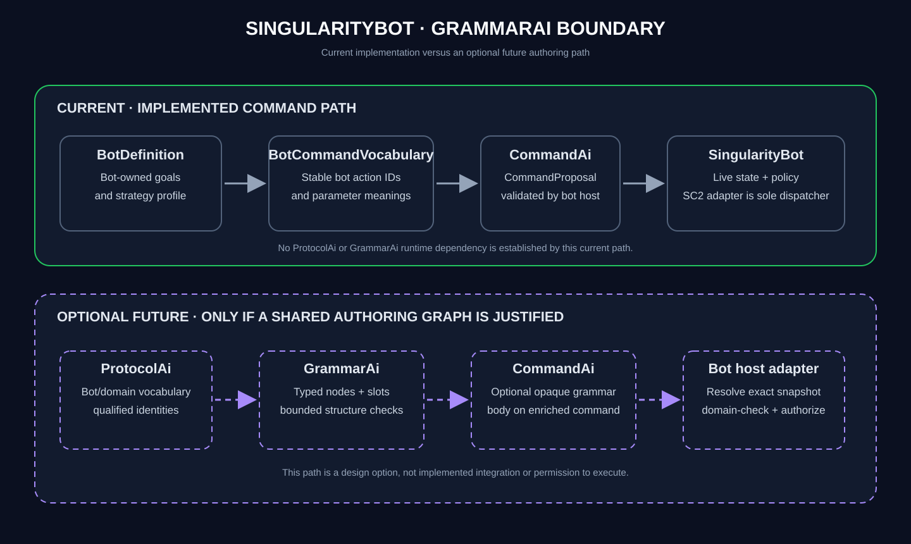

<!-- The Singularity Workshop moniker -->

# GrammarAi and SingularityBot

**Status: source-audited integration guidance. GrammarAi is not currently a SingularityBot runtime dependency.**

This page records the correct division of responsibility between [SingularityBot](https://github.com/TrentBest/TheSingularityWorkshop.SingularityBot), [ProtocolAi](https://github.com/TrentBest/TheSingularityWorkshop.ProtocolAi), [GrammarAi](https://github.com/TrentBest/TheSingularityWorkshop.GrammarAi), and [CommandAi](https://github.com/TrentBest/TheSingularityWorkshop.CommandAi). It distinguishes the implemented command path from a possible future grammar-backed authoring path.

## 1. What is implemented today

The current SingularityBot integration uses:

- **BotDefinition / BotDefinitionCatalog** for the bot's authored identity, opening goals, settings, and strategy configuration.
- **BotCommandVocabulary** for stable bot-owned action and parameter IDs.
- **CommandAi** for the provider-neutral proposal representation.
- **BotCommandProposalValidator** for validating actual CommandAi proposals against the bot-owned vocabulary.
- **BotCommandProductionProposalAdapter** for the host-side checks and bounded update to an existing production objective.
- **SingularityBot runtime and SC2 adapter** for live match policy, current-state checks, and the only path that constructs/submits StarCraft II actions.

The bot's current vocabulary is `SingularityBot.Commands/1`. Examples include `SetProductionTarget`, `ConstructBuilding`, `AssignScout`, `AssignMilitaryOperation`, and `TransitionStrategy`. Their IDs are bot-domain identities—not Blizzard unit, ability, or order IDs.

The current adapter is deliberately narrow. It requires explicit host authorization, a stable idempotency key, a valid active BotDefinition, authoritative match/game-data facts, a uniquely matching authored objective, and prerequisite ancestry. It does not submit an SC2 action. The live frame loop and SC2 adapter remain authoritative.

See the bot-owned source documentation:
- [CommandAi integration v1](https://github.com/TrentBest/TheSingularityWorkshop.SingularityBot/blob/development/docs/commandai-integration-v1.md)
- [SingularityBot architecture](https://github.com/TrentBest/TheSingularityWorkshop.SingularityBot/blob/development/docs/architecture.md)
- [SingularityBot documentation home](https://github.com/TrentBest/TheSingularityWorkshop.SingularityBot/blob/development/docs/index.md)

**Current adoption classification:** CommandAi is an implemented source-level consumer. GrammarAi and ProtocolAi are not part of the bot's declared current source dependency set. Do not describe the bot as currently using GrammarAi to validate commands, BotDefinitions, or strategy graphs.

## 2. What each package owns

| Layer | Owns | Does not own |
|---|---|---|
| ProtocolAi | Stable protocol/category and member-symbol identities; versioned event envelopes when a real exchange boundary needs them | Bot strategy, SC2 IDs, transport, authorization, execution |
| GrammarAi | Typed structural definitions, node kinds, contextual slots, cardinality, ordered relationships, grammar productions, bounded structural validation | Bot meaning, game legality, evidence truth, authorization, execution |
| CommandAi | Provider-neutral command proposals, typed arguments, enriched atomic command declarations, correlation and optional opaque grammar-body transport | Bot vocabulary meaning, grammar decoding/validation, live-state checks, authorization, execution |
| SingularityBot | BotDefinition, bot command vocabulary, domain validation, match policy, objective lifecycle and SC2 action path | Global protocol registry or a second action executor |
| SC2 adapter | Game-version-specific SC2 data mapping and action construction/submission | Cross-repository semantic vocabulary |

The layers are optional composition points, not a mandatory dependency chain. In particular, GrammarAi deliberately has no ProtocolAi runtime dependency: it carries qualified external identities and asks the host to resolve them.

## 3. When GrammarAi would add value

The current BotDefinition is already a typed, domain-owned contract with its own validation. Adding GrammarAi merely to restate its fixed JSON/C# shape would duplicate the bot's existing source of truth.

A non-duplicative GrammarAi use could emerge if Forge, an LLM authoring tool, and another independent consumer need to exchange a **shared, versioned knowledge graph** describing relationships such as:

- strategy or goal kinds;
- goal-to-subgoal relationships;
- prerequisites and dependency ancestry;
- capability/target roles;
- authored evidence requirements;
- bounded alternative or ordered strategy compositions.

That graph would be an authoring/interchange representation. The bot would map it into its existing BotDefinition and domain types, then run its own semantic validation. GrammarAi must not become the bot's runtime strategy engine or replace the BotDefinition schema.

Before adopting it, the bot owner should identify the independent producer and consumer, map real BotDefinition/domain objects (not test-only lookalikes), pin an exact GrammarAi revision, and demonstrate a validation need that the existing validators do not already cover.

## 4. The package composition if that use case is proven

A possible future path is:

1. **ProtocolAi defines vocabulary identity.** A bot-owned or shared domain catalog defines qualified category/protocol and member-symbol identities. These IDs describe stable concepts; they are not raw SC2 game-data IDs.
2. **GrammarAi defines the structural map.** A `GrammarStructureDefinition` declares grammar-owned node kinds and contextual slots. A slot declares exactly one target: another grammar node kind or an external ProtocolAi category identity. Slot cardinality and relationship order are structural constraints.
3. **The authoring tool proposes a graph.** The proposal carries the grammar definition ID and schema version. The compact wire format also carries its own wire version; those version dimensions must not be conflated.
4. **The host validates against the exact snapshot.** The bot/authoring host supplies an `IGrammarExternalReferenceResolver` bound to the exact catalog/capability snapshot used for the request. Only `ResolvedAndExposed` is accepted; unknown protocol, unknown symbol, or not-exposed references fail closed.
5. **The bot maps and validates domain meaning.** GrammarAi's successful structural validation is only one gate. SingularityBot validates the resulting domain graph against BotDefinition, current match facts, race, prerequisites, targets, and its own policy.
6. **CommandAi carries an actionable proposal when needed.** Its enriched atomic-command form may carry an optional opaque GrammarAi body. CommandAi validates the framing, version field, Base64 canonicality, and size limits; it does not decode or validate the grammar body. The consumer must bind the body to the exact expected GrammarAi definition/version and invoke GrammarAi itself.
7. **The host retains authority.** Explicit authorization, current-state checks, idempotency/replay handling, objective mutation, and SC2 action submission remain in their current owners. A valid grammar or command proposal never grants permission.

The current SingularityBot adapter uses the actual CommandAi proposal API, but its documented flow is not yet this enriched grammar-body flow. Treat steps 1–7 as an optional integration design, not shipped behavior.

## 5. CommandAi's optional grammar body is not a dependency

CommandAi's enriched atomic command can transport an opaque `CommandGrammarBody` containing a positive GrammarAi wire version and bounded payload bytes. The wire codec preserves those bytes as canonical Base64. It intentionally accepts unknown positive grammar wire versions and does not inspect the payload.

The consumer must therefore:
- recognize the expected command action and its bot-owned meaning;
- pin the expected grammar definition identity and schema version;
- verify the body's wire version and size;
- decode with the matching GrammarAi codec and exact definition;
- resolve external references against the request's exact snapshot;
- reject stale, unknown, unexposed, or structurally invalid content.

The generic observer contract token `TheSingularityWorkshop.GrammarAi.Observer@1` is a separate observer schema identity. It is not a substitute for the typed structural schema's definition ID/version and proposal wire version.

See [CommandAi usage](https://github.com/TrentBest/TheSingularityWorkshop.CommandAi/blob/development/docs/USAGE.md) for the actual enriched command contract.

## 6. ProtocolAi and the cross-process boundary

ProtocolAi is not required just because SingularityBot has integer command IDs. The bot already owns those local command identities.

ProtocolAi becomes useful only when a bot/session meaning must cross an independent repository or process boundary—for example, a bounded lifecycle event consumed by ServerSC2 or ServerApp. In that case:

- SingularityBot or the session domain defines the event's meaning and payload.
- ProtocolAi supplies the qualified event vocabulary identity and, where appropriate, EventEnvelope v1 correlation/provenance metadata.
- CommandAi remains the proposal/command body contract.
- ServerSC2 remains authoritative for SC2 process/session supervision and match/replay evidence.
- ServerApp remains authoritative for its game-neutral session/competition contract.
- No high-frequency observation or per-frame action traffic is routed through event envelopes.

This preserves the existing assessment in [SingularityBot issue #15](https://github.com/TrentBest/TheSingularityWorkshop.SingularityBot/issues/15) and the [ProtocolAi ecosystem adoption guide](https://github.com/TrentBest/TheSingularityWorkshop.ProtocolAi/blob/development/docs/ECOSYSTEM_ADOPTION_GUIDE.md). That assessment explicitly says not to replace BotCommandVocabulary, not to turn every game ability into a global symbol, and not to add a runtime dependency merely to use integer IDs internally.

## 7. Acceptance tests before adoption

A real consumer proof should use the exact pinned package/source revisions and the bot's actual domain types. At minimum, test:

- valid graph mapped into a real BotDefinition/domain object;
- unknown category, unknown member, and known-but-not-exposed external references;
- wrong target kind, wrong slot, missing required relationship, excess cardinality, and stale schema version;
- malformed, unknown-version, oversized, or duplicate-property proposal payloads;
- grammar body whose definition ID/schema version does not match the command's declared precondition;
- structurally valid but semantically invalid bot graph;
- unauthorized proposal, stale match facts, unsupported race, invalid target/prerequisite, duplicate delivery, and conflicting idempotency-key reuse;
- proof that rejection produces no objective mutation or SC2 side effect;
- proof that the SC2 adapter remains the sole action-submission path.

A green GrammarAi unit test proves only GrammarAi's own structural contract. A green CommandAi codec test proves only transport/framing. Adoption requires the real bot consumer test and exact-head CI evidence.

## 8. Current disposition and coordination

- **GrammarAi:** optional authoring/knowledge-graph adapter only; no runtime dependency.
- **ProtocolAi:** defer until a concrete cross-process event consumer is identified; preserve BotCommandVocabulary.
- **CommandAi:** current source-level proposal integration is implemented; enriched opaque grammar-body consumption by SingularityBot is not established.
- **SingularityBot:** remains owner of BotDefinition, bot command semantics, match policy, and SC2 execution.

Coordination references:
- [GrammarAi ecosystem adoption audit](ECOSYSTEM_ADOPTION_AUDIT.md)
- [GrammarAi issue #20 — ecosystem adoption coordination](https://github.com/TrentBest/TheSingularityWorkshop.GrammarAi/issues/20)
- [SingularityBot issue #12 — GrammarAi optional authoring/knowledge-graph assessment](https://github.com/TrentBest/TheSingularityWorkshop.SingularityBot/issues/12)
- [SingularityBot issue #15 — ProtocolAi cross-boundary event assessment](https://github.com/TrentBest/TheSingularityWorkshop.SingularityBot/issues/15)
- [CommandAi issue #10 — optional GrammarAi body boundary](https://github.com/TrentBest/TheSingularityWorkshop.CommandAi/issues/10)
- [ProtocolAi issue #15 — SingularityBot cross-boundary assessment](https://github.com/TrentBest/TheSingularityWorkshop.ProtocolAi/issues/15)

No dependency addition, release, merge, or deployment is implied by this guide.

---

<!-- THE SINGULARITY WORKSHOP FOOTER -->

